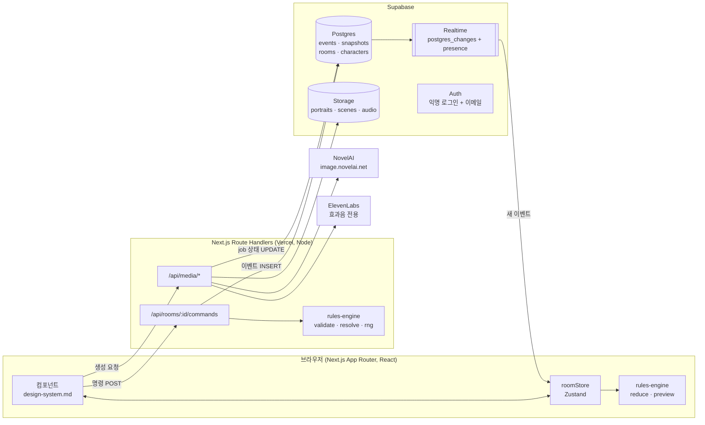
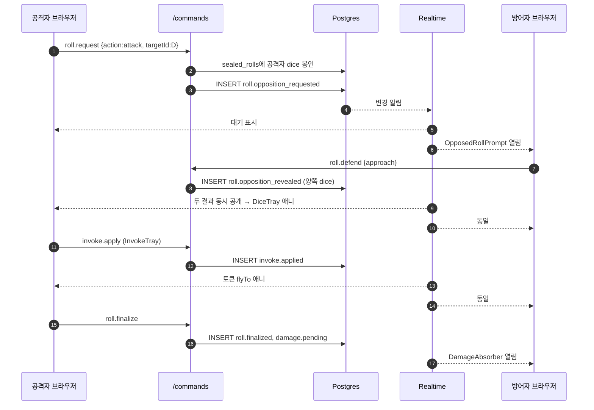
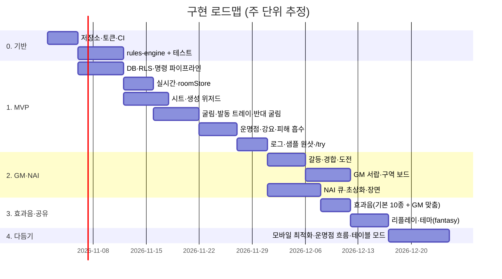

# 아키텍처 명세 v3: 기동형 페이트 툴

> 담당: 기능·구현 스레드. 화면·컴포넌트·토큰은 [design-system.md](design-system.md), 용어는 [glossary.md](glossary.md) 기준.
> 목표: 이 문서만 보고 저장소를 만들어 바로 구현을 시작할 수 있는 수준.

---

## 0. 한눈에 보기



핵심 결정 6가지
1. **모노레포**: pnpm + Turborepo. `apps/web`(Next.js 15, React 19, TypeScript strict) + `packages/rules-engine` + `packages/glossary`.
2. **명령 → 이벤트**: 클라이언트는 "하고 싶은 일"(명령)만 서버에 보냄. 서버가 rules-engine으로 검증·해석하고 **이벤트**를 DB에 쌓음. 상태는 이벤트를 리듀서로 접어서 계산.
3. **주사위는 서버에서만**: `crypto.randomInt`로 서버가 굴림. 조작 불가, 모든 화면이 같은 결과.
4. **같은 리듀서를 양쪽에서**: 서버(검증)와 클라이언트(화면 상태)가 같은 `reduce()`를 씀. 클라이언트는 낙관적 업데이트 없이 이벤트 도착 시 반영(지연 100~300ms 수준이라 충분, 단순함 우선).
5. **Supabase**: Postgres + Realtime + Auth(익명 로그인으로 링크만으로 입장) + Storage.
6. **외부 AI 키는 서버에만**: NAI·ElevenLabs 호출은 `/api/media/*`에서만. 이 환경에서는 프록시가 인증을 주입하고, 배포 시에는 Vercel 환경 변수 `NAI_API_KEY`, `ELEVENLABS_API_KEY`.

---

## 1. 폴더 구조

```
fate-table/
├─ apps/web/
│  ├─ src/app/                          # 경로는 design-system.md 5절과 1:1
│  │  ├─ page.tsx                       # /
│  │  ├─ try/page.tsx                   # /try  샘플 원샷(로컬 전용 방)
│  │  ├─ rooms/new/page.tsx             # /rooms/new
│  │  ├─ r/[roomId]/
│  │  │  ├─ page.tsx                    # 세션 3단 레이아웃
│  │  │  ├─ join/page.tsx
│  │  │  ├─ create/page.tsx             # CreationWizard
│  │  │  ├─ sheet/[charId]/page.tsx
│  │  │  └─ replay/[sessionId]/page.tsx
│  │  └─ api/
│  │     ├─ rooms/route.ts                       # POST 방 생성
│  │     ├─ rooms/join/route.ts                  # POST 초대 코드로 참가
│  │     ├─ rooms/[roomId]/state/route.ts        # GET 스냅숏 + 이후 이벤트
│  │     ├─ rooms/[roomId]/commands/route.ts     # POST 명령
│  │     ├─ media/image/route.ts                 # POST 초상화·장면 생성 job
│  │     ├─ media/sfx/route.ts                   # POST GM 맞춤 효과음 job
│  │     ├─ media/jobs/[jobId]/route.ts          # GET job 상태
│  │     └─ media/prompt-draft/route.ts          # POST 특성 → NAI 프롬프트 초안
│  ├─ src/components/                   # design-system.md 4절 폴더 그대로
│  │  ├─ aspect/ fate/ roll/ compel/ sheet/ conflict/
│  │  ├─ party/ scene/ log/ create/ media/ gm/ ui/
│  ├─ src/state/
│  │  ├─ roomStore.ts                   # Zustand: RoomState + 파생 셀렉터
│  │  ├─ selectors.ts                   # 컴포넌트별 셀렉터 (5절 표)
│  │  └─ useRoomChannel.ts              # Realtime 구독, 재접속 시 갭 메우기
│  ├─ src/server/
│  │  ├─ commands/handle.ts             # 명령 → 검증 → 이벤트 생성
│  │  ├─ commands/authz.ts              # 역할별 허용 명령
│  │  ├─ events/append.ts               # seq 할당 + INSERT (트랜잭션)
│  │  ├─ events/snapshot.ts             # 50개마다 스냅숏
│  │  ├─ media/nai.ts                   # NAI 클라이언트
│  │  ├─ media/elevenlabs.ts            # ElevenLabs 효과음 클라이언트
│  │  ├─ media/queue.ts                 # job claim·실행·재시도
│  │  ├─ media/promptDraft.ts           # 특성 텍스트 → 태그 초안
│  │  └─ supabase.ts                    # service role 클라이언트(서버 전용)
│  ├─ src/lib/                          # 클라이언트 공용(fetch 래퍼, hotkeys)
│  ├─ src/styles/tokens.css             # design-system.md 2절
│  ├─ public/sfx/                       # 빌드 전 생성한 효과음 (8절)
│  └─ src/content/                      # 샘플 캐릭터 4명, 원샷 시나리오(JSON)
├─ packages/rules-engine/
│  ├─ src/dice.ts  ladder.ts  resolve.ts  invoke.ts  damage.ts
│  ├─ src/character.ts  conflict.ts  reducer.ts  types.ts  index.ts
│  └─ test/*.test.ts                    # Vitest
├─ packages/glossary/
│  └─ src/terms.ts                      # glossary.md를 코드로 (용어 + 툴팁)
├─ supabase/
│  ├─ migrations/0001_init.sql          # 2절 스키마
│  └─ seed.sql
├─ scripts/gen-sfx.ts                   # ElevenLabs 효과음 일괄 생성
└─ turbo.json  pnpm-workspace.yaml
```

라이브러리: Zustand(상태), Zod(명령·이벤트 스키마, 서버·클라 공용), Framer Motion(모션), three.js + react-three-fiber + @react-three/rapier(3D 물리 주사위, 선택 시에만 지연 로딩), Radix Primitives(Sheet·Dialog·Tooltip 접근성), Vitest + Playwright(테스트), fflate(NAI zip 해제).

---

## 2. 데이터베이스 스키마 (Supabase Postgres)

원칙: **진실은 `events`**. `characters`·`aspects` 같은 테이블은 목록 화면·검색용 **투영(projection)** 으로, 이벤트 기록 시 서버가 같은 트랜잭션에서 갱신. 방 화면은 스냅숏 + 이벤트만으로 그림.

```sql
-- 0001_init.sql
create type member_role as enum ('gm','player','spectator');
create type visibility  as enum ('public','gm','owner');
create type job_status  as enum ('queued','running','done','failed','canceled');
create type media_kind  as enum ('portrait','scene','npc','sfx');

create table rooms (
  id            uuid primary key default gen_random_uuid(),
  name          text not null check (char_length(name) between 1 and 60),
  invite_code   text not null unique,            -- 8자 base32
  theme         text not null default 'paper',    -- paper | fantasy
  ai_enabled    boolean not null default true,
  ai_quota      jsonb not null default '{"image":40,"sfx":30}', -- 방별 월 한도
  created_by    uuid not null references auth.users(id),
  created_at    timestamptz not null default now()
);

create table profiles (                           -- 사용자 개인 설정
  user_id  uuid primary key references auth.users(id) on delete cascade,
  settings jsonb not null default '{}'             -- diceMode, dice3dQuality, volume, sfxEnabled 등
);

create table room_members (
  room_id   uuid references rooms(id) on delete cascade,
  user_id   uuid references auth.users(id),
  role      member_role not null,
  nickname  text not null,
  joined_at timestamptz not null default now(),
  primary key (room_id, user_id)
);

create table sessions (                          -- 플레이 세션(회차)
  id         uuid primary key default gen_random_uuid(),
  room_id    uuid not null references rooms(id) on delete cascade,
  number     int  not null,
  title      text,
  started_at timestamptz not null default now(),
  ended_at   timestamptz,
  unique (room_id, number)
);

create table events (
  room_id     uuid not null references rooms(id) on delete cascade,
  seq         bigint not null,                    -- 방 안에서 1부터 연속
  session_id  uuid references sessions(id),
  type        text not null,                      -- 3절 목록
  actor_id    uuid references auth.users(id),     -- null = 시스템
  payload     jsonb not null,
  visibility  visibility not null default 'public',
  owner_id    uuid,                               -- visibility='owner'일 때 볼 수 있는 사람
  client_cmd  uuid,                               -- 명령 멱등 키
  created_at  timestamptz not null default now(),
  primary key (room_id, seq),
  unique (room_id, client_cmd, type)
);
create index on events (room_id, session_id, seq);

create table room_snapshots (
  room_id  uuid references rooms(id) on delete cascade,
  seq      bigint not null,                       -- 이 seq까지 반영된 상태
  state    jsonb not null,                        -- 공개 상태만 (GM 비공개 정보 제외)
  gm_state jsonb not null,                        -- GM 전용 추가 필드
  primary key (room_id, seq)
);

-- 투영 테이블
create table characters (
  id          uuid primary key,
  room_id     uuid not null references rooms(id) on delete cascade,
  owner_id    uuid references auth.users(id),     -- null = GM 소유 NPC
  is_npc      boolean not null default false,
  name        text not null,
  portrait_id uuid,
  data        jsonb not null,                     -- rules-engine Character 그대로
  updated_seq bigint not null
);

create table aspects (                            -- 캐릭터·장면·구역 공통
  id            uuid primary key,
  room_id       uuid not null references rooms(id) on delete cascade,
  owner_type    text not null check (owner_type in ('character','scene','zone')),
  owner_id      uuid not null,
  kind          text not null check (kind in ('high','trouble','normal','situation','consequence','boost')),
  text          text not null,
  free_invokes  int  not null default 0 check (free_invokes >= 0),
  hidden        boolean not null default false,   -- GM만 (발견 전 특성)
  updated_seq   bigint not null
);

create table media_assets (
  id          uuid primary key default gen_random_uuid(),
  room_id     uuid not null references rooms(id) on delete cascade,
  kind        media_kind not null,
  storage_path text not null,                     -- bucket 'media'
  prompt      jsonb not null,                     -- 재생성용 원본 요청
  cache_key   text not null,                      -- sha256(kind + 정규화 프롬프트)
  created_by  uuid references auth.users(id),
  created_at  timestamptz not null default now(),
  unique (room_id, cache_key)
);

create table media_jobs (
  id          uuid primary key default gen_random_uuid(),
  room_id     uuid not null references rooms(id) on delete cascade,
  kind        media_kind not null,
  provider    text not null check (provider in ('nai','elevenlabs')),
  request     jsonb not null,
  status      job_status not null default 'queued',
  attempts    int not null default 0,
  result_ids  uuid[] not null default '{}',       -- media_assets
  error       text,
  requested_by uuid references auth.users(id),
  created_at  timestamptz not null default now(),
  started_at  timestamptz,
  finished_at timestamptz
);
create index on media_jobs (provider, status, created_at);

create table ai_usage (                           -- 한도 집계
  room_id uuid references rooms(id) on delete cascade,
  month   date not null,
  images  int not null default 0,
  sfx    int not null default 0,
  primary key (room_id, month)
);
```

### RLS (행 수준 보안)
```sql
create function is_member(r uuid) returns boolean language sql stable as
$$ select exists(select 1 from room_members where room_id = r and user_id = auth.uid()) $$;
create function is_gm(r uuid) returns boolean language sql stable as
$$ select exists(select 1 from room_members where room_id = r and user_id = auth.uid() and role = 'gm') $$;

alter table events enable row level security;
create policy events_read on events for select using (
  is_member(room_id) and (
    visibility = 'public'
    or (visibility = 'gm' and is_gm(room_id))
    or (visibility = 'owner' and (owner_id = auth.uid() or is_gm(room_id)))
  ));
-- INSERT/UPDATE는 정책 없음 → 클라이언트 직접 쓰기 불가. 서버(service role)만 기록.

alter table aspects enable row level security;
create policy aspects_read on aspects for select using (
  is_member(room_id) and (not hidden or is_gm(room_id)));

-- profiles: 본인만 읽기·쓰기 (user_id = auth.uid())
-- rooms, room_members, characters, sessions, media_assets, media_jobs: is_member 읽기, 쓰기는 서버만
-- room_snapshots: 클라이언트 접근 없음. /state 라우트가 역할에 맞게 state 또는 state+gm_state를 내려줌
```
Storage 버킷 `media`: 비공개, 경로 `rooms/{roomId}/{kind}/{assetId}.{png|mp3}`, 읽기는 `is_member` 정책으로 서명 URL 발급.

---

## 3. 이벤트 목록 (진실의 원천)

공통 봉투: `{ roomId, seq, sessionId, type, actorId, payload, visibility, ownerId?, createdAt }`.
명령은 같은 이름의 동사형(`roll.request` → 이벤트 `roll.resolved`). Zod 스키마는 `packages/rules-engine/src/types.ts`에 하나로 정의해 서버·클라 공용.

### 3-1. 방·세션·장면
| 이벤트 | payload | 공개 | 리듀서 규칙 |
|---|---|---|---|
| `room.member_joined` | userId, nickname, role | public | members 추가 |
| `session.started` | sessionId, number, title | public | 모든 PC 운명점 = max(현재, 재충전). 이전 세션 경상 회복 처리 |
| `session.ended` | sessionId, summary? | public | 중상(회복 중) 해제 표시 |
| `scene.started` | sceneId, name, aspects[{id,text,hidden}], zones[], backgroundAssetId? | public(hidden 특성은 별도 gm 이벤트) | currentScene 교체, **GM 풀 = 장면에 있는 PC 수**(누적 아님, 재설정) |
| `scene.ended` | sceneId | public | 모든 스트레스 비움, 장면·구역 특성과 부스트 삭제 |

### 3-2. 캐릭터
| 이벤트 | payload | 공개 | 리듀서 |
|---|---|---|---|
| `character.created` | character(전체) | public | 추가 (validateCharacter 통과 필수) |
| `character.updated` | id, patch(이름, 접근법, 특기, 초상화) | public | 병합 후 재검증 |
| `milestone.granted` | characterIds[], size('minor'\|'significant'\|'major') | public | 해당 캐릭터에 변경 가능 플래그 |

### 3-3. 특성
| 이벤트 | payload | 공개 | 리듀서 |
|---|---|---|---|
| `aspect.added` | aspect{id, ownerType, ownerId, kind, text, freeInvokes, hidden} | hidden이면 gm | 추가 |
| `aspect.revealed` | aspectId | public | hidden=false |
| `aspect.updated` | aspectId, text | public | |
| `aspect.removed` | aspectId, reason | public | 삭제 |

### 3-4. 굴림과 발동 (핵심)
| 이벤트 | payload | 공개 | 리듀서 |
|---|---|---|---|
| `roll.resolved` | rollId, characterId, action, approach, rating, dice[4], animSeed(uint32, 모든 화면이 같은 궤적을 쓰기 위한 값), modifiers[{source,value}], difficulty?, opposedBy? | public* | rolls[rollId] 생성, 상태 `open` |
| `roll.opposition_requested` | rollId, defenderId, action:'defend' | public | 상태 `awaiting_defense` (공격자 dice는 아직 숨김*) |
| `roll.opposition_revealed` | rollId, attacker{dice,…}, defender{dice,…} | public | 양쪽 동시 공개, 상태 `open` |
| `invoke.applied` | rollId, side('active'\|'defense'), aspectId, mode('bonus'\|'reroll'), paidWith('fate_point'\|'free_invoke'), newDice? | public | +2 또는 dice 교체, 운명점 −1 또는 freeInvokes −1, 부스트면 삭제 |
| `stunt.applied` | rollId, stuntId, value | public | modifiers 추가 |
| `roll.finalized` | rollId, total, shifts, outcome, rewards[] | public | 상태 `final`. rewards 처리는 후속 이벤트로 |

\* 반대 굴림: 서버가 공격자 dice를 클라이언트가 읽을 수 없는 전용 테이블 `sealed_rolls`에 봉인(GM에게도 미리 보이지 않도록 events에는 넣지 않음). 방어자 굴림이 오면 `roll.opposition_revealed`로 한 번에 공개.

```sql
create table sealed_rolls (room_id uuid, roll_id uuid primary key, attacker jsonb not null, created_at timestamptz default now());
alter table sealed_rolls enable row level security;   -- 정책 없음 = 클라이언트 접근 불가
```

### 3-5. 운명점과 강요
| 이벤트 | payload | 공개 | 리듀서 |
|---|---|---|---|
| `fate.adjusted` | characterId \| 'gm_pool', delta, reason('manual'\|'concede'\|'compel'\|'refresh'\|'invoke_against') | public | 점수 변경 (0 미만 불가) |
| `compel.offered` | compelId, aspectId, targetId, text | public | pendingCompels 추가 |
| `compel.accepted` | compelId | public | 대상 +1, GM 풀 변화 없음 |
| `compel.refused` | compelId | public | 대상 −1 (0이면 거절 불가 → 서버가 명령 거부) |
| `compel.withdrawn` | compelId | public | 삭제 |

다른 캐릭터의 특성을 그 캐릭터에게 불리하게 발동하면 그 캐릭터가 운명점 1을 받음. 원래 규칙은 장면이 끝날 때 지급이지만, 툴은 입문자 이해를 위해 즉시 지급(`fate.adjusted` reason=`invoke_against`).

### 3-6. 피해와 갈등
| 이벤트 | payload | 공개 | 리듀서 |
|---|---|---|---|
| `conflict.started` | conflictId, kind('physical'\|'mental'), participants[], order[] | public | 순서는 rules-engine `turnOrder()` 결과 |
| `conflict.turn_advanced` | conflictId, index, round | public | |
| `conflict.ended` | conflictId | public | |
| `damage.pending` | rollId, targetId, shifts | public | 대상에게 DamageAbsorber 열림 |
| `damage.absorbed` | rollId, targetId, stressBox(1\|2\|3\|null), consequences[{slot, aspectId, text}] | public | 스트레스 체크, 후유증 특성 생성(무료 발동 1, 공격자 측) |
| `character.conceded` | characterId, conflictId, fpGained | public | 운명점 +1 + 이번 갈등에서 받은 후유증 수 |
| `character.taken_out` | characterId, conflictId | public | 탈락 표시 |
| `consequence.recovery_started` | aspectId | public | 회복 중 표시 |
| `consequence.cleared` | aspectId | public | 삭제 |
| `contest.started` / `contest.exchange` / `contest.ended` | 승리 카운트 | public | 먼저 3승 |
| `challenge.started` / `challenge.step` / `challenge.ended` | steps[] | public | |

### 3-7. 장면 보드·로그·미디어
| 이벤트 | payload | 공개 |
|---|---|---|
| `zone.added` / `zone.linked` / `zone.removed` | zoneId, name, x, y / from, to | public |
| `token.moved` | characterId, zoneId | public |
| `chat.posted` | text, as?(NPC 이름) | public |
| `gm.note` | text | gm |
| `narration.posted` | text (GM 서술, 로그에 강조 표시. 음성 없음) | public |
| `sfx.played` | assetId (기본 효과음 키 또는 맞춤 효과음) | public |
| `media.attached` | assetId, kind, target(characterId \| sceneId) | public |
| `event.undone` | targetSeq, reason | public (GM만 명령 가능, 리듀서는 대상 이벤트를 건너뛰고 재계산) |

---

## 4. API (Route Handlers)

모든 응답은 `{ ok: true, data }` 또는 `{ ok: false, error: { code, message } }`. 인증은 Supabase 세션 쿠키(익명 로그인 포함).

| 메서드·경로 | 요청 | 응답 | 비고 |
|---|---|---|---|
| `POST /api/rooms` | name, theme, aiEnabled | roomId, inviteCode | 생성자 = GM |
| `POST /api/rooms/join` | inviteCode, nickname | roomId, role | 기본 player |
| `GET /api/rooms/:id/state?after=seq` | | snapshot(역할별), events[] , headSeq | 재접속 갭 메우기에도 사용 |
| `POST /api/rooms/:id/commands` | clientCmdId(uuid), type, payload | events[] (생성된 것) | 아래 처리 순서 |
| `POST /api/media/prompt-draft` | characterId 또는 aspects[], style | positive, negative (편집용 문자열) | 규칙 기반 변환, 생성 아님 |
| `POST /api/media/image` | roomId, kind('portrait'\|'scene'\|'npc'), prompt, negative, size, count(1~4), target | jobId, position(대기 순번) | 한도 검사 → 캐시 적중 시 즉시 done |
| `POST /api/media/sfx` | roomId, description(영문 변환 전 한국어 가능), durationSec(0.5~5), loop? | jobId | GM만, 방별 월 30개 |
| `GET /api/media/jobs/:id` | | status, position, assets[{id,url}] | Realtime 대체용 폴링 |

### 명령 처리 순서 (`server/commands/handle.ts`)
1. Zod로 명령 파싱 → 2. `authz`: 역할 확인(예: `compel.offer`, `scene.start`, `event.undo`, `fate.adjust`는 GM만, 굴림은 자기 캐릭터만) → 3. `select ... for update`로 방의 head seq 잠금 → 4. 스냅숏+이후 이벤트로 현재 상태 복원(메모리 LRU 캐시로 보통은 생략) → 5. rules-engine `validate(state, command)` → 6. `resolve(state, command, rng)`가 이벤트 배열 생성 → 7. 같은 트랜잭션에서 events INSERT + 투영 테이블 갱신 → 8. 50개마다 스냅숏 → 9. 응답.
- **멱등**: 같은 `clientCmdId` 재전송 시 기존 이벤트 반환.
- **오류 코드**: `NOT_MEMBER`, `FORBIDDEN_ROLE`, `NOT_ENOUGH_FATE_POINTS`, `ASPECT_ALREADY_INVOKED`, `ROLL_NOT_OPEN`, `INVALID_CHARACTER`, `QUOTA_EXCEEDED`, `STALE_STATE`(재시도).

### 명령 목록
`session.start`, `session.end`, `scene.start`, `scene.end`, `character.create`, `character.update`, `aspect.add`, `aspect.reveal`, `aspect.update`, `aspect.remove`, `roll.request`(action, approach, characterId, difficulty?, targetId?), `roll.defend`(rollId, approach), `invoke.apply`(rollId, aspectId, mode, paidWith), `stunt.apply`, `roll.finalize`, `fate.adjust`, `compel.offer`, `compel.respond`(accept\|refuse), `compel.withdraw`, `conflict.start`, `conflict.next`, `conflict.end`, `damage.absorb`, `character.concede`, `consequence.startRecovery`, `consequence.clear`, `zone.*`, `token.move`, `chat.post`, `gm.note`, `narration.post`, `sfx.play`, `milestone.grant`, `event.undo`.

---

## 5. 실시간 설계



- **채널 1개/방**: `room:{roomId}`.
  - `postgres_changes`: `events` INSERT, filter `room_id=eq.{roomId}` (RLS로 비공개 이벤트 자동 필터), `media_jobs` UPDATE.
  - `presence`: `{ userId, nickname, role, characterId, status: 'idle'|'choosing'|'rolling'|'typing'|'away' }` (탭이 숨겨진 지 60초 또는 heartbeat 끊김 → 'away', presence 이탈 → 오프라인) → PartyRail의 "고르는 중…"·자리 비움·오프라인 표시.
  - `broadcast`(비권위, 저장 안 함): `pointer`(GM이 장면 카드 가리키기), `typing`.
- **순서 보장과 갭 메우기**: 클라이언트는 `lastSeq`를 들고, 도착한 이벤트 seq가 `lastSeq+1`이 아니면 버퍼에 넣고 `GET /state?after=lastSeq`로 빈 곳을 채운 뒤 순서대로 적용.
- **재접속**: 채널 재구독 시 항상 `GET /state?after=lastSeq` 한 번.
- **애니메이션 규칙**: 이벤트 적용 시 `fx` 큐에 연출 항목 추가(`{type:'token_fly', from, to}` 등). 초기 로드·갭 메우기로 들어온 이벤트(도착 시각이 현재-3초 이전)는 연출 생략.
- **비공개 정보**: GM 비공개 특성·메모는 visibility로 RLS가 거름. 스냅숏은 `/state`가 역할에 따라 `state` 또는 `state ⊕ gm_state`를 내려줌.

### 컴포넌트별 구독 셀렉터 (`src/state/selectors.ts`)
| 컴포넌트 | 셀렉터 | 반응하는 이벤트 |
|---|---|---|
| `PartyRail`, `CharacterMini` | `selectParty()` → {id, name, portraitUrl, fatePoints, stress[3], consequences, presence} | character.*, fate.adjusted, damage.absorbed, invoke.applied, compel.* |
| `AspectBoard` | `selectSceneAspects()` | scene.*, aspect.* |
| `AspectCard` | `selectAspect(id)` + `selectInvokability(rollId, aspectId)` | aspect.*, invoke.applied |
| `FateEconomyBar` | `selectFateFlow(sessionId)` → [{from,to,count}] | fate.adjusted, invoke.applied, compel.accepted/refused, character.conceded |
| `DiceTray`, `OutcomeBanner` | `selectActiveRoll()` | roll.*, invoke.applied, stunt.applied |
| `InvokeTray` | `selectInvokeOptions(rollId)` = rules-engine `previewInvokes()` | 동일 |
| `OpposedRollPrompt` | `selectPendingDefense(myCharacterId)` | roll.opposition_requested |
| `CompelOffer` | `selectPendingCompels(myCharacterId)` | compel.* |
| `DamageAbsorber` | `selectPendingDamage(myCharacterId)` + `absorbOptions()` | damage.pending |
| `ZoneBoard` | `selectZones()` | zone.*, token.moved |
| `StoryLog` | `selectLog()` → LogEntry[] (이벤트를 문장으로, 용어집 사용) | 전부 |
| `MediaJobToast` | `selectMyJobs()` | media_jobs UPDATE |
| `GmDrawer` | `selectGmView()` | gm.note, hidden aspect, 모든 pending |

### 5-2. 주사위 연출 (보는 사람마다 선택)

결과는 언제나 서버가 정함(`roll.resolved.dice`). 연출은 **각 사용자가 고르는 표시 방식**일 뿐이라, 한 방 안에서 사람마다 다른 모드를 써도 결과와 타이밍은 같음.

| 모드 | 설명 | 기술 | 기본값 |
|---|---|---|---|
| `dice3d` | 사용자 GPU로 렌더링하는 물리 3D 주사위. 테이블 위로 던져져 구르고 멈춤 | three.js + react-three-fiber + @react-three/rapier(WASM 물리) | WebGL2 지원 + 성능 기준 통과 시 데스크톱 기본 |
| `flicker` | 주사위 4개의 눈(+/빈칸/−)이 실시간으로 빠르게 바뀌다가 순서대로 멈춤. CSS/Framer Motion만 사용 | DOM + requestAnimationFrame | 모바일·저사양 기본 |
| `instant` | 연출 없이 결과만 | - | `prefers-reduced-motion` 시 자동 |

**3D에서 서버 결과대로 멈추게 하는 방법 (결과 맞춤 시뮬레이션)**
1. 굴림 버튼을 누르면 즉시 손 안에서 흔드는 대기 연출 시작(서버 응답 100~300ms 가림).
2. `roll.resolved` 도착 → `animSeed`로 초기 위치·회전·힘을 정함 → Rapier로 **화면에 그리지 않고** 고정 스텝(1/120초) 시뮬레이션을 멈출 때까지 돌려 궤적(프레임별 위치·회전)을 기록. 보통 1~2초 분량, 계산은 수 ms.
3. 각 주사위가 실제로 위를 향해 멈춘 면을 확인하고, 서버 결과 면이 그 자리에 오도록 **주사위 면 배치를 회전 매핑**(4dF는 +, −, 빈칸이 각 2면씩이라 매핑이 항상 가능).
4. 기록한 궤적을 재생. 같은 `animSeed`·같은 시뮬레이션 상수라 모든 화면에서 같은 궤적이 나옴(Rapier는 같은 입력이면 결정적).
5. 다시 굴림(`invoke.applied` mode=reroll): `newDice`와 새 animSeed로 같은 과정.
6. 반대 굴림: 두 사람의 주사위를 서로 다른 색 세트로 같은 테이블에 동시에 던짐.

**성능·폴백 규칙**
- `Dice3D` 청크는 사용자가 `dice3d`를 쓸 때만 동적 import(초기 번들 영향 없음). 로딩 중에는 `flicker`로 표시.
- 시작 시 WebGL2 여부, `renderer.capabilities`, 첫 3초 평균 FPS를 확인. 45fps 미만이 계속되면 품질 단계 하향(그림자 끄기 → 해상도 0.75배 → 반사 끄기), 그래도 부족하면 `flicker`로 자동 전환하고 토스트로 알림. WebGL 컨텍스트 손실 시도 같은 폴백.
- 탭이 숨겨진 상태에서 도착한 굴림은 연출 생략.
- 주사위 재질·테이블 색은 테마 토큰에서 가져옴: `--dice-body`, `--dice-edge`, `--dice-pip`, 반대 굴림 상대용 `--dice-body-op`/`--dice-edge-op`/`--dice-pip-op`, `--dice-table` (값은 design-system.md 17절). `Dice3D`는 마운트 시 `getComputedStyle`로 읽어 재질에 적용하고 테마 변경 시 다시 읽음.

**설정**
- 사용자 설정 `diceMode: 'auto'|'dice3d'|'flicker'|'instant'`, `dice3dQuality: 'auto'|'high'|'medium'|'low'`. localStorage에 저장하고 로그인 계정이면 프로필(`profiles.settings` jsonb)에도 저장.
- 설정 화면과 굴림 영역의 작은 토글 두 곳에서 바꿀 수 있음.
- 효과음 `dice-roll`·`dice-settle`은 두 모드 모두 재생 시점(던짐·멈춤)에 맞춰 울림. 3D는 주사위가 바닥에 닿는 충돌 이벤트마다 짧게 재생(최대 6회).

---

## 6. rules-engine 명세 (`packages/rules-engine`)

외부 의존성 없음(Zod 제외), 순수 함수, 100% 단위 테스트 대상.

```ts
// types.ts
export type Approach = 'careful'|'clever'|'flashy'|'forceful'|'quick'|'sneaky';
export type Action = 'overcome'|'create_advantage'|'attack'|'defend';
export type Outcome = 'fail'|'tie'|'success'|'style';
export type DieFace = -1|0|1;
export type AspectKind = 'high'|'trouble'|'normal'|'situation'|'consequence'|'boost';
export type ConsequenceSlot = 'mild'|'moderate'|'severe';

export interface Stunt { id: string; text: string;
  kind: 'bonus'|'once_per_session';
  bonus?: { approach: Approach; action: Action; value: 2 }; usedThisSession?: boolean }
export interface Character { id: string; name: string; isNpc: boolean;
  approaches: Record<Approach, number>; stunts: Stunt[];
  refresh: number; fatePoints: number; stress: [boolean, boolean, boolean];
  consequences: Partial<Record<ConsequenceSlot, { aspectId: string; recovering: boolean }>> }
export interface Aspect { id: string; ownerType: 'character'|'scene'|'zone'; ownerId: string;
  kind: AspectKind; text: string; freeInvokes: number; hidden: boolean }

// dice.ts
export type Rng = (maxExclusive: number) => number;          // 서버: crypto.randomInt
export function rollFateDice(rng: Rng): [DieFace,DieFace,DieFace,DieFace];
export function sumDice(d: DieFace[]): number;

// ladder.ts
export const LADDER: Record<number, string>;                 // glossary 연동: 8 전설 … -2 최악
export function ladderLabel(n: number): string;               // 범위 밖은 "전설+2" / "최악-1"

// resolve.ts
export function outcomeOf(shifts: number): Outcome;           // <0 fail, 0 tie, 1~2 success, ≥3 style
export function resolveRoll(r: RollState): { total: number; shifts: number; outcome: Outcome };
export type Reward =
  | { type: 'success_at_minor_cost' } | { type: 'success_at_serious_cost_option' }
  | { type: 'boost'; to: 'self'|'opponent' } | { type: 'new_aspect'; freeInvokes: 1|2 }
  | { type: 'free_invoke_on_existing'; count: 1|2 } | { type: 'opponent_free_invoke_option' }
  | { type: 'damage'; shifts: number } | { type: 'damage_or_boost'; shifts: number };
export function rewardsFor(action: Action, outcome: Outcome, shifts: number): Reward[];

// invoke.ts
export function canInvoke(roll: RollState, aspect: Aspect, payer: Character):
  { ok: true } | { ok: false; code: 'NOT_ENOUGH_FATE_POINTS'|'ASPECT_ALREADY_INVOKED'|'HIDDEN' };
export function previewInvokes(roll: RollState, aspects: Aspect[], payer: Character):
  Array<{ aspectId: string; mode: 'bonus'|'reroll'; outcomeAfter: Outcome; improves: boolean; free: boolean }>;
export function applyInvoke(roll: RollState, inv: InvokeInput, rng?: Rng): RollState;

// damage.ts
export interface AbsorbPlan { stressBox: 1|2|3|null; consequences: ConsequenceSlot[]; remaining: number }
export function absorbOptions(shifts: number, c: Character): AbsorbPlan[];
// remaining=0인 조합만. 정렬: 최소 손실 우선 = 후유증 개수 적은 순 → 사용한 후유증 중 가장 무거운 슬롯이 가벼운 순(경상<중상<중태) → 스트레스 칸 번호 작은 순. 없으면 [] (탈락/양보만)
export function concedeReward(consequencesTakenThisConflict: number): number; // 1 + n

// character.ts
export function validateCharacter(c: Character):
  { ok: true } | { ok: false; issues: Array<'APPROACH_SPREAD'|'TOO_MANY_STUNTS'|'MISSING_HIGH'|'MISSING_TROUBLE'> };
export function refreshFor(stuntCount: number): number;       // max(1, 3 - max(0, stuntCount - 3))
export function startOfSessionFatePoints(c: Character): number; // max(c.fatePoints, c.refresh)
export function stuntBonuses(c: Character, action: Action, approach: Approach): Stunt[];

// conflict.ts
export function turnOrder(kind: 'physical'|'mental', ps: Character[]): string[]; // physical=신속, mental=신중 내림차순, 동률은 이름순
export function clearAfterScene(state: RoomState): RoomState;                    // 스트레스·부스트·장면 특성 정리

// reducer.ts
export function reduce(state: RoomState, e: RoomEvent): RoomState;
export function validate(state: RoomState, cmd: Command, actor: Actor): ValidationResult;
export function resolve(state: RoomState, cmd: Command, actor: Actor, rng: Rng): RoomEvent[];
```

규칙 기준(코드 주석으로도 남김)
- 접근법 기본 분배 +3×1, +2×2, +1×2, +0×1. 특기 3개까지 무료, 넘을 때마다 재충전 −1(최소 1).
- 발동: 같은 굴림에 같은 특성은 한 번만(무료 발동은 예외로 중복 사용 가능). 부스트는 무료 발동 1회 후 삭제.
- 스트레스: 한 번의 피해에 칸 하나만, 칸 번호만큼 흡수. 후유증 경상2·중상4·중태6, 여러 개 동시 사용 가능.
- GM 운명점 풀: 장면 시작마다 그 장면의 PC 수로 재설정.
- 회복: 경상은 회복 행동 후 다음 장면 끝, 중상은 다음 세션 끝, 중태는 시나리오 끝(GM이 `consequence.clear`).
- 양보: 운명점 1 + 이번 갈등에서 받은 후유증 수.

### 테스트 케이스 (최소 세트, `test/`)
| # | 대상 | 입력 | 기대 |
|---|---|---|---|
| 1 | outcomeOf | -1 / 0 / 2 / 3 | fail / tie / success / style |
| 2 | ladderLabel | 3, -2, 10 | 양호, 최악, 전설+2 |
| 3 | rollFateDice | 고정 rng [0,1,2,1] | [-1,0,1,0] |
| 4 | rewardsFor | overcome, tie | success_at_minor_cost |
| 5 | rewardsFor | create_advantage, style | new_aspect(2) |
| 6 | rewardsFor | attack, tie | boost(self) |
| 7 | rewardsFor | attack, style, 4 | damage_or_boost(4) |
| 8 | rewardsFor | defend, style | boost(self) |
| 9 | previewInvokes | 합계 1 vs 난이도 2, 특성 1개, 운명점 1 | bonus → success, improves=true |
| 10 | canInvoke | 운명점 0, 무료 발동 0 | NOT_ENOUGH_FATE_POINTS |
| 11 | canInvoke | 같은 특성 두 번째 유료 발동 | ASPECT_ALREADY_INVOKED |
| 12 | applyInvoke | 부스트로 발동 | 부스트 삭제 |
| 13 | absorbOptions | 피해 3, 스트레스 모두 빔 | 첫 제안 {stressBox:3, consequences:[]} |
| 14 | absorbOptions | 피해 5, 3번 칸 사용됨 | 첫 제안 {1, [중상]}, 3번 칸을 쓰는 제안 없음 |
| 15 | absorbOptions | 피해 16, 전부 사용 가능 (최대 흡수 3+2+4+6=15) | [] (탈락/양보만) |
| 16 | validateCharacter | +3,+3,+2,+1,+1,0 | APPROACH_SPREAD |
| 17 | refreshFor | 5 | 1 |
| 18 | turnOrder | physical, 신속 3/1/2 | 3,2,1 순 |
| 19 | reduce | session.started, 운명점 5 재충전 3 | 5 유지 |
| 20 | reduce | compel.refused, 운명점 0 | validate가 NOT_ENOUGH_FATE_POINTS |
| 21 | reduce | scene.ended | 스트레스 비움, 장면 특성·부스트 삭제, 후유증 유지 |
| 22 | reduce | event.undone(seq k) | k를 뺀 재계산 결과와 동일 |
| 24 | reduce | scene.started, PC 4명, GM 풀 1 | GM 풀 4 |
| 25 | absorbOptions | 피해 4, 스트레스 모두 빔 | 첫 제안 {stressBox:2, [경상]}, 그다음 {3,[경상]}, {null,[중상]} 순 |
| 23 | 속성 기반 | 임의 이벤트 시퀀스 | 운명점 ≥ 0, 무료 발동 ≥ 0 불변식 |

---

## 7. NovelAI 연동

- 엔드포인트: `POST https://image.novelai.net/ai/generate-image` (응답: PNG가 든 zip → fflate로 해제). 이 환경에서 모델 이름 `nai-diffusion-4-5-full`이 유효함을 확인(파라미터 검증 단계까지 통과).
- 요청 골격 (`server/media/nai.ts`):
```ts
{ input: positive, model: 'nai-diffusion-4-5-full', action: 'generate',
  parameters: { width, height, n_samples: 1, steps: 28, scale: 5, sampler: 'k_euler_ancestral',
    noise_schedule: 'karras', seed, negative_prompt: negative,
    v4_prompt: { caption: { base_caption: positive, char_captions: [] }, use_coords: false, use_order: true },
    v4_negative_prompt: { caption: { base_caption: negative, char_captions: [] } } } }
```
- 크기 프리셋: 초상화 832×1216, 장면 1216×832, NPC 토큰 1024×1024. 후보 4장은 `n_samples:1`로 4번 순차 실행(동시 요청 제한 회피).
- **동시성**: 키당 1건만 실행. `media/queue.ts`가 `update media_jobs set status='running' where id = (select id from media_jobs where provider='nai' and status='queued' order by created_at for update skip locked limit 1) and not exists (select 1 from media_jobs where provider='nai' and status='running')`로 하나씩 꺼냄. 요청 라우트는 job을 넣고 `after()`로 워커 1회 실행, 워커는 큐가 빌 때까지 반복. 429면 지수 백오프(2,4,8초) 3회.
- **프롬프트 초안**(`promptDraft.ts`): 생성형 AI 없이 규칙 기반. 테마별 화풍 태그 + 특성 텍스트에서 사전 매핑(예: "기사"→`knight, armor`, "마법"→`mage, robe`) + 사용자가 직접 수정. 한국어 사전은 `src/content/prompt-dictionary.json`. 초상화 기본 negative에 품질·노출 관련 태그 포함(전연령 기본, 방 설정으로 변경 불가).
- **캐시**: `cache_key = sha256(kind|model|정규화 프롬프트|크기|seed)`. 같은 키면 생성 없이 기존 자산 반환.
- **한도**: 방별 월 이미지 40장(기본, 방 설정에서 GM이 조정). 초과 시 `QUOTA_EXCEEDED`.

## 8. ElevenLabs 연동 (효과음 전용, 사용자 결정)

> 음성 읽기(TTS)·NPC 목소리는 쓰지 않음. 연결된 키도 `/v1/sound-generation` 권한만 있어 이 결정과 맞음(실측 확인).

- 엔드포인트: `POST https://api.elevenlabs.io/v1/sound-generation` `{ text, duration_seconds, prompt_influence?, loop? }` → mp3. 프롬프트는 영어가 잘 동작하므로 GM 입력 한국어는 간단한 사전 + 직접 수정 칸으로 영어 문구 초안을 만듦.
- **기본 효과음 10종**: `scripts/gen-sfx.ts`가 빌드 전에 한 번 생성해 `public/sfx/`에 커밋. 실시간 호출 없음. `dice-roll`, `dice-settle`, `token-flip`, `token-fly`, `success`, `style-chime`, `fail-thud`, `compel-card`, `consequence-slot`, `scene-transition` (각 0.5~2초). 이벤트 → 효과음 매핑은 클라이언트 `fx` 큐가 담당(모션과 같은 타이밍).
- **GM 맞춤 효과음**(P2): GM 서랍 '효과음' 탭에서 "문이 삐걱 열리는 소리" 같은 설명 → 생성 → 방 라이브러리에 저장 → 버튼으로 `sfx.play` → 모든 참가자 동시 재생. 장면 분위기용 `loop: true` 앰비언트(최대 30초 루프)도 같은 경로.
- 큐: NAI와 같은 `media_jobs`(provider='elevenlabs'), 동시 2건까지.
- 재생: 첫 상호작용 전 자동 재생이 막히므로 입장 시 "소리 켜기" 1회. 개인 볼륨·음소거는 localStorage. `prefers-reduced-motion`과 별개로 효과음 끄기 설정 제공.
- 한도: 방별 월 맞춤 효과음 30개(기본). 같은 설명·길이는 캐시.

## 9. 보안·운영
- Auth: Supabase 익명 로그인으로 초대 링크만 열면 입장, 나중에 이메일 연결로 계정 유지.
- Rate limit: 명령 사용자당 초당 10건, 미디어 요청 분당 6건(Upstash 없이 Postgres 카운터로 시작).
- 로그: 서버 오류는 Vercel 로그, 명령 거부율·평균 처리 시간은 `events`로 집계 가능.
- 백업: Supabase 일일 백업. 세션 내보내기(마크다운/JSON)로 사용자 쪽 보관도 가능.
- 라이선스: 규칙 문구는 Fate Accelerated(CC BY 3.0, Evil Hat) 기반임을 앱 정보 화면에 표기.

---

## 10. 단계별 작업 분해



### 작업 목록 (완료 기준 포함)
**0. 기반**
- T01 모노레포 생성(pnpm, Turborepo, Next.js, TS strict, ESLint, Prettier). 완료: `pnpm dev`, `pnpm test` 동작.
- T02 `tokens.css`, 폰트, 테마 스위처(`data-theme-mode`, `data-genre`). 완료: 라이트/다크/fantasy 전환.
- T03 `packages/glossary`. 완료: `term('aspect')` → "특성" + 툴팁.
- T04 rules-engine 타입·dice·ladder·resolve·rewards. 완료: 테스트 1~8 통과.
- T05 invoke·damage·character·conflict. 완료: 테스트 9~18 통과.
- T06 reducer·validate·resolve(명령→이벤트). 완료: 테스트 19~23 통과.
- T07 GitHub Actions: lint, typecheck, test, Playwright 스모크.

**1. MVP**
- T10 Supabase 마이그레이션 0001 + RLS + seed. 완료: 다른 방 이벤트 조회 불가 테스트.
- T11 `/api/rooms`, `/join`, `/state`. 완료: 익명 사용자 2명이 같은 방 입장.
- T12 `/commands` 파이프라인(잠금, 멱등, 투영, 스냅숏). 완료: 같은 clientCmdId 2회 → 이벤트 1개.
- T13 `useRoomChannel` + `roomStore` + 갭 메우기. 완료: 네트워크 끊김 후 재접속 시 상태 일치.
- T14 `CharacterSheet`, `StressTrack`, `ConsequenceSlots`, `CharacterMini`, `PartyRail`.
- T15 `CreationWizard`(6단계), `ApproachAllocator`, `StuntComposer`. 완료: 검증 오류가 단계 안에서 안내됨.
- T16 `ActionBar`, `DiceTray`(눈 바뀜 모드), `LadderBadge`, `OutcomeBanner`(문구표). 완료: 단축키 1–4/QWEASD/Space.
- T16b 3D 물리 주사위 모드(5-2절): `Dice3D` 지연 로딩, 결과 맞춤 시뮬레이션, 성능 자동 폴백, 설정 화면 선택지. 완료: 같은 animSeed로 두 브라우저에서 같은 궤적·같은 결과, 중급 노트북 60fps.
- T17 `InvokeTray` + `previewInvokes` 강조. 완료: 결과를 바꾸는 카드만 강조.
- T18 반대 굴림(`sealed_rolls`, `OpposedRollPrompt`). 완료: 방어자 응답 전 공격자 결과가 어느 화면에도 없음.
- T19 `FatePointToken` 애니, `CompelOffer`, GM 운명점 풀.
- T20 `DamageAbsorber` + 양보·탈락.
- T21 `StoryLog`/`LogEntry` 문장화, `chat.post`.
- T22a 샘플 시나리오 JSON 스키마 `src/content/oneshot/*.json`: `{ characters[], scenes[], triggers[] }`. 트리거 형식 `{ id, when: { event: 'roll.finalized', nth?: 1, where?: {...} }, then: Command[], once: true }`. 로컬 방 런타임이 이벤트 적용 후 트리거를 검사해 `then` 명령을 GM(시스템) 이름으로 실행. 기본 트리거: 첫 `roll.finalized` 직후 플레이어 캐릭터의 약점에 `compel.offer`(코치마크 5단계와 연결).
- T22 `/try` 샘플 원샷(로컬 방: 서버 없이 rules-engine만으로 동작, 같은 리듀서). 완료: 첫 방문부터 첫 굴림까지 5분 이내(사용성 테스트 3명).
- T23 MVP 플레이 테스트: 실제 1세션 완주, 버그 목록화.

**2. GM·NAI**
- T30 갈등 트래커(`turnOrder`, 라운드), 경합·도전 진행표.
- T31 `GmDrawer`(강요·NPC 빠른 생성·장면·메모·이정표).
- T32 `ZoneBoard` + `token.moved`.
- T33 `media_jobs` 큐 + NAI 클라이언트 + 캐시 + 한도.
- T34 `PortraitPicker`(프롬프트 초안 편집, 후보 4장), `MediaJobToast`.
- T35 장면 배경 생성 → `SceneStage` 적용.

**3. 효과음·공유**
- T40 `gen-sfx.ts`로 효과음 10종 생성 + 재생 훅(개인 볼륨).
- T41 GM 맞춤 효과음: `/api/media/sfx` + 큐 + GM 서랍 '효과음' 탭(생성·라이브러리·재생 버튼), `sfx.played`로 모두에게 재생.
- T42 `/replay/[sessionId]` 읽기 전용 리플레이 + 마크다운 내보내기.
- T43 `fantasy` 테마.

**4. 다듬기**
- T50 모바일 탭·바텀 시트 최적화(모바일 3D 품질 프리셋 포함).
- T51 `FateEconomyBar` 운명점 흐름 그래프.
- T52 테이블 모드(보기 전용 큰 화면 경로 `/r/[roomId]/table`).
- T53 외부 플레이 테스트와 만족도 설문(5점 척도: 규칙 이해, 몰입, 속도).
